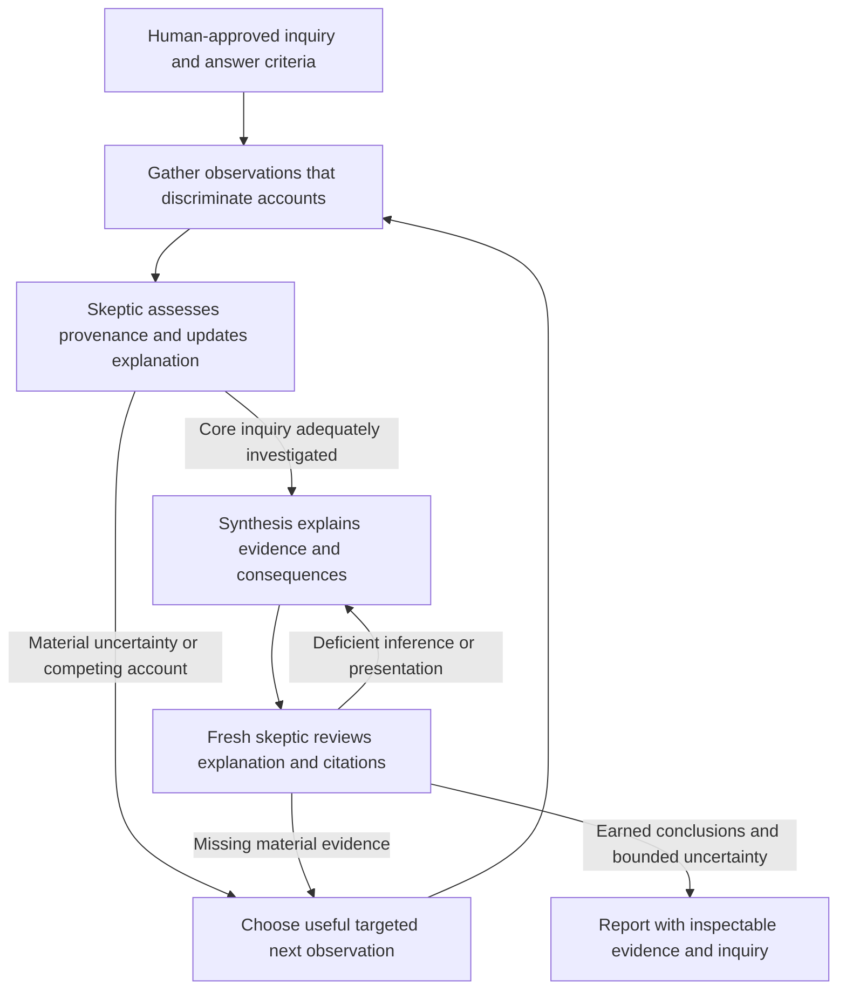

# Deep Research: investigation rather than attributable description

## User-visible objective

Produce a coherent explanation grounded in investigated evidence: how the subject operates,
which claims are established, how relevant actors/resources/decisions/outcomes connect, what
competing explanations remain, and why the remaining uncertainty is bounded. A summary may
be readable and concise while the investigation and supporting analysis are substantial.

The prior neutral-topic run completed, matched its quotations, survived restart and passed
an AI rubric, yet the user correctly rejected its shallow reliance on the subject's own
account. Twelve of 21 cited findings were classified first-party. Adding attribution did
not investigate central claims. Preserve that failure and the valid execution evidence;
do not turn a revised rubric, extra schema or longer output into proof of research quality.

The supplied [shared conversation](https://chatgpt.com/share/6ad41533-1fd4-832f-9aed-3c9b6d629837)
informs the separation of investigative policy, persistent evidence/understanding and
presentation. It is conceptual input, not a specification of private OpenAI implementation.

## What the system represents

| Domain object | Meaning and ownership |
| --- | --- |
| Approved inquiry requirement | A question, its evidentiary need and substantive answer criteria. The planner proposes it; human Start binds its exact identity. |
| Observed evidence | Immutable actual source passages, origins and role-specific read receipts. A source's existence is not its interpretation. |
| Source provenance | Claim-specific subject/affiliate/external/unclear relationship, account type, checked basis and funding/governance/data/citation dependencies. Skeptic judgment stays inspectable and fallible. |
| Evolving inquiry | The current explanation against each criterion, supporting and contrary evidence, uncertainty and a useful next action. The skeptic may update it without ending the stage. |
| Conclusion | The proposed answer and public reasoning, supporting/contrary admissions, alternative accounts, confidence and uncertainty. Synthesis owns its expression; source checking cannot automatically establish its merits. |
| Investigated gap | A specific unanswered fact and relevant attempted alternatives, with exact actual search queries. Recording attempts is necessary operational evidence, not proof that the efforts were adequate. |
| Review | Exact-output citation judgments and a separate substantive inquiry assessment. Human/external evaluation can overturn an AI quality pass. |

Evidence needs distinguish declared positions, documented specifications and independent
assessment. Primary evidence means proximity to events or data; it does not privilege the
subject's publicity. Interested records may be informative within their remit. An audited
filing, a funded study and a quoted denial have different authority and dependencies. Neither
domain diversity nor a categorical ban on interested sources is a valid independence test.

## Adaptive control

These are responsibilities of the existing native coordinator and roles, not a required
swarm topology. The model chooses investigative actions. Code preserves scope, role/record
ownership, current references and recoverability. No claim is made that prompt changes
reproduce research-specific model training.

An inquiry update should say what observation could change a consequential explanation,
not narrate private chain of thought. Progress is new discriminating evidence, a revised
account or a genuinely ruled-out approach. Tool counts, admitted-source counts, a new graph
node and a list of caveats do not establish progress or completion.

## Implementation and boundaries

The native Rust plugin remains in `Peritus-Module-Market/modules/deep-research`. The host
continues to own provider routing, permissions, web tools, daemon lifecycle and private module
state. No provider adapter or live user daemon is changed for this increment.

- `Plan.investigation` saves an evidence need and answer criteria per question.
- Admissions save structured provenance with actual read-backed basis passages. Quoted
  self-reports retain their subject relationship. Qualified subject/affiliate evidence alone
  cannot close an independent-assessment criterion.
- `research_inquiry` saves provisional answers, support/contrary IDs and next actions.
  Coverage can explicitly defer nonessential planner detail, with a reason. Deferral is not
  an investigated gap and cannot justify a fully answered status. Unused discoveries do not
  create mandatory assessment debt. Draft early from useful vetted evidence.
- Report conclusions retain the evidence-to-inference connection. Supported/contested
  dispositions require answered criteria; investigated gaps and deferred optional detail remain partial/unknown.
- The final reviewer can reject a deficient explanation early without pretending unchecked
  citations were checked. Approval still requires all current-digest citation judgments and
  a substantive inquiry assessment.
- Human `inquiry` and source-role labels expose the evidence model. Existing paged report,
  evidence, restart and Design attachment consumers continue through the same native ABI.

Mechanical constraints reject missing references, stale assessments, fabricated recorded
search attempts and incompatible self-report credit. They cannot determine that a complex
claim is true, a source relationship was classified correctly, a search was useful, or an
explanation is adequate. Those questions require semantic assessment and real output review.

Report length is presentation, not an investigative budget. Stop when consequential reader
questions are adequately established and uncertainty has been investigated and bounded.
Do not pursue every reachable source; do not stop because accurately attributed statements
can be assembled. No cumulative token, source, time or revision limit is added to the product.

## Compatibility and recovery

New fields deserialize with conservative legacy defaults and are omitted when absent,
preserving the exact legacy approved-plan digest. Old source checks are not inherited as
new independent-inquiry approval. The prior report remains readable with a legacy label;
`reassess` reopens assessment against the same approved question and retained evidence.
Immutable historical reports and approvals remain intact. This does not introduce automatic
state migration across package-digest directories; copied-state replays state that boundary.

Input errors remain recoverable tool observations. A material follow-up preserves useful
work, returns to gathering and reassessment, and targets the saved uncertainty. Existing
durable citation progress and context-fit repair remain in place to prevent rereading loops.

## Real acceptance

The prospective independent rubric is frozen under
`/tmp/peritus-research-independence-20261017/oracle/` and retained byte-for-byte in
[the repository](../docs/testing/research-quality-rubric-v2.md). Its structured JSON SHA-256 is
`ce0a81bb408570beaef8b8378552cbb10a76256d94a2d8bf28fcc4bf217bd823`.
It evaluates actual conduct/implementation, resource/control paths, interested framing,
consequential corroboration, outcomes/contribution, accountability mechanisms, explanatory
integration, adaptive investigation and epistemic fairness. It requires no citation quota,
fixed topology or predetermined sentiment. Topic-specific diagnostics are not sent to jobs.

Operate the actual native IPC on copies of real retained evidence to replay rejection,
recovery, legacy identity and fresh-process persistence. Separately submit the unchanged
neutral topic through actual TUI/daemon/live-provider/web paths. Inspect its evidence
trajectory and final report against the frozen substantive rubric. Reopen through a fresh
daemon, read every report page and exact evidence, and exercise ordinary chat afterward.
Keep mechanical and research-quality results separate. A compiled plugin or a successful
structural replay is not completion of the research-quality repair.

The credible alternative is prompt-only strengthening. It is smaller, but leaves source
relationships, answered criteria and inference links outside inspectable domain state and
allows the same attribution-for-investigation substitution to recur silently. The chosen
increment couples model-directed investigation with explicit, fallible evidence judgments;
it does not attempt a deterministic truth engine.

## Delivery correction after actual failure

The first v1.2 live campaign ran 73 minutes, made 764 tool calls, retained 66 candidates
and 231 reads, and produced no report. The user correctly identified disproportionate
minutiae. Valid individual leads did not justify the aggregate delay. Mandatory assessment
of the entire discovery queue, exhaustive planner-criterion closure, unused-candidate coverage
invalidation and question-exclusive evidence were artificial delivery blockers.

Version 1.3 removes those dependencies. Discovery question tags organize navigation, not
evidence authority. An explanation must establish relevance when reusing current vetted
evidence across questions. Coverage validates its used evidence rather than the entire queue.
The planner and roles prioritize a useful early draft; additional research must identify a
consequential claim, a discriminating observation and a stopping condition. Repeated provenance
checks without a new reason are not progress.

Human `finish` persists delivery steering: retain existing observations, assess useful evidence,
qualify unknowns and write the report. It disables fresh searches, opens and followup agendas,
while retained-source reads and exact-report checking remain available. `reassess` explicitly
reopens investigation. This is not a new cumulative token/time/source budget.

## Controversy discovery and attribution

The user explicitly distinguishes reporting a controversy from adjudicating it. A separate
controversy researcher searches live after general gathering, follows materially connected
people/institutions and alternative framings, and preserves concrete accusations, attribution,
responses and documented outcomes. Skeptical admission checks authentic attribution and scope;
it does not require proof of guilt before reporting an allegation. Original statements can
establish that a claim was made even when they cannot establish the underlying events.
Synthesis retains a dedicated Controversies and criticism section. Review checks that the
case substance survived, without deciding guilt or treating a denial as dispositive.

The failed neutral campaign remains a failure. The remake uses additional user-provided leads;
a better user-steered report cannot retroactively establish successful neutral discovery.
The report and all available source materials are retained outside the repository. After
report delivery, the separately authorized continuous, steerable Sicko mode remains next.

## Continuous research: Sicko mode

Explicit user selection enables continuous research on the same approved plan and retained
corpus. Normal research remains the default. Sicko mode has no cumulative token, wall-time,
source or round budget. Resource bounds apply to individual frames/operations and host
concurrency; cancellation and changing user authority still interrupt work.

The plugin, rather than a provider adapter, owns the policy. At each exact-report review
boundary it returns the generic SDK `Checkpoint` action. Peritus durably presents that text
and refreshes the module's actions before acknowledging the checkpoint. The plugin then
starts another gathering round against the saved inquiry frontier and current steering.
This makes reports available during a continuing job. A final-Reply-only loop would hide
all results until the user stopped it; inserting report prose in model prompts would not
provide a durable host publication boundary.

`steer DETAILS` journals directions and replaces the current direction in future prompts,
retaining the approved task and evidence. `pause` persists the current stage and mode;
`resume` continues them. `normal` pauses and disables automatic continuation. `finish`
disables continuous mode and requests delivery from current evidence. No source or model
can activate this mode: only explicit human module commands select it. GUI action selection
and TUI `/module` commands use the same native implementation.

The latest checked Markdown and its hash have their own durable pointer. Later discovery
or an incomplete new draft cannot erase that usable checkpoint. `checkpoint [BYTE_OFFSET]`
reads it, and explicit Design attachment uses those same retained bytes. A crash between
host publication and acknowledgement can publish the same stable checkpoint again; this
is at-least-once delivery, not a claim of transactional exactly-once publication. Existing
Reply/Model modules keep their current behavior. Checkpoint-capable plugins require an
updated host and matching SDK contract; older hosts do not gain the action automatically.

Read-only commands in active continuous mode use the same publication/acknowledgement
boundary and continue the retained phase with a new role revision. Merely asking for status
or viewing an older report must not silently end research. Paused jobs stay paused during
inspection. Design reuse is an explicit handoff: the plugin persists paused state and attaches
the immutable checkpoint, with Resume available afterward.
