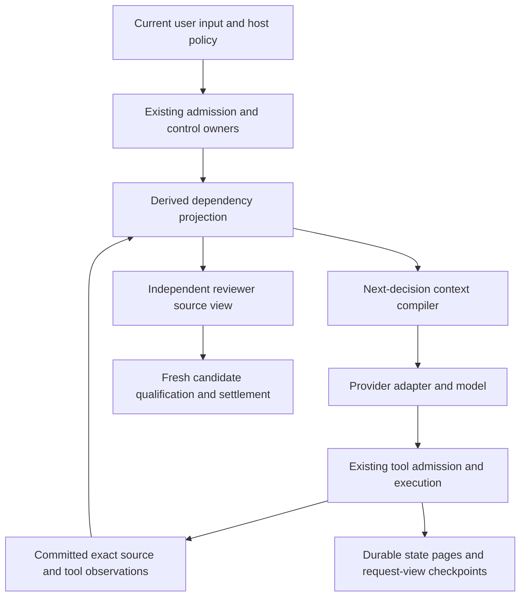

# Feature: Incremental execution and token efficiency

Status: implementation design. Authored October 28, 2026 against `develop` at
`d58ccbed426fba0a361a6533bb4ddb80726ba2ce`, including the working-tree state inspected during
the design investigation. Current implementation and qualification evidence are tracked in
[the implementation ledger](incremental-execution-efficiency.progress.md). Proposed improvements
remain hypotheses until their relevant real-operation campaigns establish them.

## Summary

Make Peritus process changes to a run instead of repeatedly reconstructing its accumulated
state. Use the existing journal, immutable evidence, context graph, role isolation, tool
admission, and candidate settlement owners as one coordinated incremental pipeline.

The intended result is lower time to useful action, fewer model requests, fewer total input
tokens, and less repeated local I/O while preserving every existing product capability and
the evidence needed to establish its result. The model supplies judgments and proposals;
the host carries out deterministic continuations through its existing authority boundaries.

Deliver this in independently useful increments. Start with source indexing, immutable page
reuse, and duplicate provider-schema removal. Then improve request compilation and introduce
conservative dependency tracking and optional read-only operation plans. A large rewrite,
another agent runtime, and an additional model used to route work are unnecessary.

Performance improvements remain hypotheses until measured on the actual application. Static
operation counts below establish repeated work, not its share of end-to-end latency.

## User-visible behavior

Existing Chat, Design, Plan, Review, Build, native modules, managed Git workspaces, plain folders,
attachments, browser/desktop tools, external effects, provider selection/failover, and recovery
remain available through their current interfaces. This feature introduces no new approval
round, task execution budget, or required cloud service.

The user should observe faster progress between meaningful decisions. A long-running command
can continue under host ownership without repeated model requests solely to ask whether it
has finished. Source inspection can retrieve several explicitly requested related ranges in
one operation. Steering, stopping, changing permissions, or providing interactive input remains
responsive while this work proceeds.

Efficiency observations describe actual calls, submitted input, reported usage, and local work.
They distinguish total input tokens from cached input tokens, unavailable counters from zero,
and elapsed execution time from user pauses. The product never declares completion because an
optimization target or an experiment's measurement window has been reached.

## Requirements

| ID | Requirement |
| --- | --- |
| R01 | Preserve the existing capability set and caller-visible contracts. Optimize work performed to provide a capability; do not eliminate a role, tool, delivery mode, required verification, or supported provider to obtain a lower cost. |
| R02 | Preserve literal current user requirements, current host policy, live permission checks, scoped source authority, and pending/unknown effect state in every applicable request and operation admission. |
| R03 | Retain exact evidence, source identities, retrieval ranges, historical observations, and continued operation as history grows. Introduce no lifetime observation, entry, token, request, retry, or elapsed-time quota. Existing explicit caller constraints and per-operation representability/resource limits continue to apply. |
| R04 | Publish the same required durable boundaries before dependent work or provider submission. Reuse must preserve checkpoint atomicity, artifact reachability, source validation, corruption detection, and crash recovery. |
| R05 | Avoid re-encoding and rewriting sealed, unchanged checkpoint pages. Attribute serialization, content verification, metadata validation, physical writes, and synchronization separately. |
| R06 | Replace repeated linear source searches with checked indexed lookup and incrementally maintained derived metadata without changing selection, ordering, omission, or error semantics. |
| R07 | Preserve complete tool argument and result validation while eliminating duplicate schema delivery. Keep every currently permitted tool reachable. Any later schema selection must preserve discoverability and include its additional requests in the cost comparison. |
| R08 | Measure and optimize the final adapter projection, including its framing and schema overhead. Preserve instruction/evidence origins and provider capabilities; never equate a logical common prefix with a confirmed provider cache hit. |
| R09 | Compile a next-decision view from current requirements, unresolved work, relevant exact evidence, and complete protocol dependencies. References cannot stand in for source bytes the model needs to make that decision. |
| R10 | Invalidate derived knowledge conservatively when its inputs change. Unknown or incomplete dependencies require broader invalidation; model-declared dependencies cannot establish that other inputs are irrelevant. |
| R11 | Reduce repeated workspace observations only where the consuming operation's freshness and ownership contract is preserved. Keep exact target admission and full candidate verification wherever a safe replacement has not been demonstrated. |
| R12 | Offer optional typed read-only operation plans and host-owned waits for existing command handles. Admit each step against current authority, preserve ordered exact results, and stop at a decision that requires model judgment. |
| R13 | Preserve cancellation, new-input fencing, process ownership, idempotency, and unknown-outcome reconciliation. Restarting an optimization must not redispatch an effect. |
| R14 | Preserve independent reviewer context and exact candidate/requirement-bound qualification. Share only eligible source observations and actual host outcomes; writer conclusions, omitted-range coverage, or optimization metadata cannot establish acceptance. |
| R15 | Preserve readable historical data and provide independent rollback of each optimization. Optimization indexes are rebuildable and cannot become a second authority or a prerequisite for opening a valid legacy run. |
| R16 | Demonstrate improvements with comparable real-interface campaigns and report successful completion, failed/retried work, token usage, local cost, latency, and coverage together. Do not count fewer successful outcomes or weaker evidence as an improvement. |

## Acceptance criteria

| ID | Observable completion condition | Requirements |
| --- | --- | --- |
| A01 | Run representative existing modes, workspace types, module stages, tools, and selected providers before and after each relevant increment. Each task still satisfies its independent user-visible acceptance; retained capabilities remain callable. | R01, R07, R14, R16 |
| A02 | Grow retained history through multiple sealed pages, continue the run, and inspect physical writes. Unchanged sealed pages are not re-encoded or rewritten, and every published checkpoint retains its complete dependency roots. | R03–R05 |
| A03 | Interrupt before artifact finalization, before checkpoint publication, after publication, after a tool batch, and before the next request. Restart in a fresh process and recover the appropriate exact state without losing the completed batch or inventing a submitted request. | R02, R04, R13, R15 |
| A04 | Remove, truncate, replace, or corrupt a referenced artifact in disposable state. The optimized path detects the problem at the required existing boundary and reports it; a cached reference never converts corruption into success. | R04, R05, R15 |
| A05 | Replay the same committed inputs through reference and indexed selectors. Ordered selected observations, ranges, omissions, pins, and rejection reasons match; source visits and key computations no longer grow through nested history scans. | R02, R06 |
| A06 | Capture actual OpenCode projections for automatic, required, specific, and unavailable tool choices. Full argument definitions occur once in the chosen layout, all required validation remains, and real tool/terminal turns remain correctly decoded. | R01, R07, R08 |
| A07 | Change only volatile host metadata and compare successive final adapter projections. Account for the earliest changed segment, framing, schemas, and provider-reported cached usage separately; no origin is promoted or omitted to improve the prefix metric. | R02, R08 |
| A08 | Complete a sustained task across context reconstruction, role/provider changes, and source amendments. The next-decision view retains literal instructions, relevant exact contracts, pending state, and meaningful continuation; omitted evidence remains exactly retrievable. | R02, R03, R09, R10 |
| A09 | Modify a relevant file, an unrelated file, Git metadata, permissions, toolchain/configuration, or an externally referenced source. Observe conservative invalidation and fresh candidate qualification. A lost change signal or unknown command write set triggers the required broader observation. | R10, R11, R14 |
| A10 | Execute read-only plans with multiple dependent reads, pagination, inaccessible paths, changing files, and no results. Each step receives ordinary admission, exact child outcomes remain retrievable, and an ambiguous next choice returns control instead of guessing. | R02, R03, R12 |
| A11 | Stop, steer, or revoke permission between plan steps and while waiting on a live command. No disallowed later step dispatches; completed outcomes remain durable and the user can supply input or take control. | R02, R12, R13 |
| A12 | Crash while a command is running or its terminal outcome is being published. Reconcile the original command handle and receipts. A timeout, missing response, or unknown state never causes automatic redispatch. | R04, R12, R13 |
| A13 | Place distinct writer scratch markers and authoritative source markers in a disposable campaign. Reviewer requests may contain eligible source bytes but exclude writer scratch conclusions. Final acceptance still requires the existing current evidence. | R09, R14 |
| A14 | Reopen supported historical checkpoints and run with each optimization disabled. Rollback preserves current committed observations and command ownership; unsupported new data is handled explicitly without silently selecting an older state. | R03, R04, R15 |
| A15 | Publish a baseline and changed campaign with identical task scope, provider/model settings, fresh/warm-state labeling, and independent outcome evaluation. Report total/cached input, output/reasoning where available, retries, time to useful action, completion latency, and local-work counters. | R01, R08, R16 |

## Current architecture

The human product path is client → daemon `ProductRunService` → `ProductRunner` →
`DeveloperLoop` → provider and host-owned tools. The journal-backed domain drivers are related
machinery with separate ownership; this feature does not replace or merge them.

The investigation traced the following current paths. It was not a completed whole-repository
audit, live-provider benchmark, or finding that these paths dominate every workload.

| Owner and source | Current behavior and design consequence |
| --- | --- |
| [ProductRunService](../crates/app/peritus-daemon/src/product_run.rs), [live interaction](../crates/app/peritus-daemon/src/product_run/interaction/live.rs) | The daemon owns admission, current conversation, permissions, and execution control. Optimization cannot take over these decisions. |
| [ProductRunner](../crates/app/peritus-product-runner/src/execution.rs), [attempt driver](../crates/app/peritus-product-runner/src/execution/driver.rs) | Design, writing, checks, independent review, fixes, and settlement compose the product run. These responsibilities remain. |
| [DeveloperLoop](../crates/orchestration/peritus-agent/src/developer/execution.rs), [context port](../crates/orchestration/peritus-agent/src/developer/context_port.rs) | The loop builds a request, obtains proposals, executes calls sequentially, records their observations, and checks live control. Prepared context is checkpointed before submission. |
| [Local context port](../crates/app/peritus-product-runner/src/local_context/port.rs), [configuration](../crates/app/peritus-product-runner/src/context_config.rs) | Default local mode also prepares and publishes a view after a completed batch. The next model step prepares and publishes its current view again. The two boundaries may have different governing state. |
| [Checkpoint pages](../crates/app/peritus-product-runner/src/local_context/pages.rs), [page encoder](../crates/orchestration/peritus-context/src/working/wire/pages.rs), [publication](../crates/app/peritus-product-runner/src/local_context/memory/checkpoint.rs) | Every view publication enumerates all working-state pages and all source-index chunks, then stores manifests, transcript, view, validation, and checkpoint. Addressing pages by digest does not itself avoid this work. |
| [LocalStore](../crates/app/peritus-product-runner/src/local_context/storage.rs), [artifact writer](../crates/state/peritus-artifact-store/src/writer.rs), [publication helper](../crates/state/peritus-artifact-store/src/finalize.rs) | Store calls create and write a temporary object. Finalization synchronizes it before discovering an identical destination, verifies existing bytes, synchronizes directories, and records catalog metadata. |
| [Memory ingestion](../crates/app/peritus-product-runner/src/local_context/memory/ingestion/pending.rs), [evidence ranking](../crates/app/peritus-product-runner/src/local_context/assembly/evidence.rs), [checked source lookup](../crates/app/peritus-product-runner/src/local_context/memory.rs) | Protocol pin reconstruction and ranking use repeated source scans despite contiguous observation identities and an existing checked direct lookup. |
| [Context assembly](../crates/app/peritus-product-runner/src/local_context/assembly.rs), [working view](../crates/app/peritus-product-runner/src/local_context/assembly/working.rs), [transport fitting](../crates/app/peritus-product-runner/src/local_context/assembly/transport.rs) | Assembly already preserves policy, selects complete exchanges, retains working state, restores exact evidence, and orders cacheable prefixes. Selection remains influenced by provider capacity and historical exchange epochs. |
| [Environment capture](../crates/app/peritus-product-runner/src/local_context/memory/environment.rs), [workspace checkpoint](../crates/app/peritus-product-runner/src/progress.rs), [managed capture](../crates/runtime/peritus-workspace/src/task_candidate/managed/capture.rs) | Managed context refresh captures repository identity through enumeration, file hashing, and private Git tree construction. Plain folders have a different task-scoped boundary and cannot use Git assumptions. |
| [File observations](../crates/app/peritus-product-runner/src/file_observation.rs), [decoded-message cache](../crates/app/peritus-product-runner/src/local_context/memory/decoded.rs), [read reuse](../crates/app/peritus-product-runner/src/local_context/read_reuse.rs) | These optimizations already exist. Unix file observations have metadata guards; other platforms conservatively read content. They do not eliminate managed repository capture or checkpoint publication. |
| [OpenCode request](../crates/model/peritus-provider-opencode/src/request.rs) | Output-schema variants contain argument definitions/descriptions, and the prompt catalog repeats them. The adapter lifts system/developer messages into its system text, so final prefix behavior differs from logical message order. |
| [Codex request](../crates/model/peritus-provider-openai/src/runtime/request.rs), [cache routing](../crates/model/peritus-provider-openai/src/runtime/provider/cached.rs) | This adapter already has specific framing, strict inert tool output, and cache affinity through ephemeral children. Persistent vendor conversation is not a prerequisite for the proposed improvements. |
| [Resume knowledge](../crates/app/peritus-product-runner/src/execution/resume/knowledge.rs), [invalidation](../crates/orchestration/peritus-run-knowledge/src/plan.rs) | Product resume builds six broad dependency sections. Existing working entries also support exact file dependencies. Extend those mechanisms rather than creating unrelated knowledge authority. |
| [Candidate checkpoints](../crates/app/peritus-product-runner/src/execution/checkpoint.rs), [reviewer](../crates/app/peritus-product-runner/src/reviewer_turn.rs), [acceptance](../crates/app/peritus-product-runner/src/execution/acceptance.rs) | Current qualification depends on exact candidate/requirements and evidence. Saved observations and coverage notices cannot become a cached acceptance verdict. |
| [Efficiency observations](../crates/app/peritus-product-runner/src/efficiency.rs), [view accounting](../crates/app/peritus-product-runner/src/local_context/assembly/validation.rs) | Existing content-free observations provide a starting point. Logical estimated input savings and common-prefix counts are not measurements of final adapter framing or actual provider billing. |

### Static checkpoint amplification

For `N > 0` retained observations and zero through 64 working entries, the inspected code writes:

```text
working pages = ceil(N / 512) + 3   # header, entry page, protocol page
source pages  = ceil(N / 512)
other objects = 6                  # two page manifests, transcript, view, validation, checkpoint
artifact finalizations per view checkpoint = 2 * ceil(N / 512) + 9
```

At 10,000 observations this is 49 finalizations per view checkpoint, or 98 for a normal
continuing batch followed by its next request with default checkpoint settings. At 100,000 it
is 401 and 802 respectively. These counts exclude ordinary observation/event writes and assume
successful paths with the stated page layout. They are not measured latency, bytes, or fsync
counts. More working-entry pages increase the count.

### Related designs

[Retained-state growth](keep-working-retained-state.md) requires exact paged history and continued
operation beyond former ceilings. [Local working memory](local-working-memory.md) establishes
local ownership and non-authoritative evidence. [Staged project execution](staged-project-execution.md)
proposes separate stage/task/role contexts and shared structured handoffs. This design preserves
those boundaries without requiring the proposed project tracker to be implemented first.

## Proposed design

### 1. Common representation and ownership

Use a host-maintained dependency projection over existing committed records. Authoritative user
inputs, permissions, command receipts, candidate checkpoints, and settlement remain in their
current owners. The projection connects them; it does not copy authority into a new database.



| Responsibility | Owner |
| --- | --- |
| Pure dependency identities, closures, invalidation, deterministic selection | Existing `peritus-context` and `peritus-run-knowledge` domains, respecting current dependency direction. |
| Evidence ingestion, physical page reuse, projection persistence, context compilation | `peritus-product-runner` local-context adapter using existing journal/artifact services. |
| Invocation timing, control fences, model/tool transcript | `peritus-agent::DeveloperLoop` and its context/tool ports. |
| Concrete final request framing and provider usage | Existing provider adapters and `peritus-provider-core` contracts. |
| Workspace freshness, snapshots, process ownership, tool permissions | Existing workspace/process/tool runtimes and daemon control owners. |
| Independent qualification and terminal handoff | Existing reviewer, candidate checkpoint, and settlement composition. |

Proposed internal concepts are `EvidenceDependency`, `StatePageSet`, `DecisionFrontier`,
`CompiledRequestView`, and `ReadOnlyOperationPlan`. These are design names, not implemented
public Rust types or promised filenames. Prefer private checked types and existing identities;
do not expose storage internals or create new architectural package dependencies casually.

### 2. Establish a comparable cost ledger

Extend existing efficiency observations to distinguish:

- Provider submissions by role, reason, attempt, and actual terminal outcome; preparation and
  cache-routing setup are separate from submitted inference.
- Provider-reported total input, cached input, cache creation, output, and reasoning usage where
  available. Record whether counters are cumulative or per-request and never double-count them.
- Final adapter input bytes/characters and component sizes for policy, schemas, framing, exact
  source, conversation, derived state, and live control. Estimates remain explicitly estimates.
- Context assembly/validation time, archive lookups, bytes encoded/hashed/read/written, new and
  reused pages, artifact finalizations, checkpoint commits, and managed fingerprint work.
- Time to first useful action, time waiting for providers/tools, and end-to-end settlement time.

Instrumentation must be non-authoritative and content-free. Keep prompt text, source bodies,
arguments, credentials, raw paths, and private reasoning out of efficiency logs. Compute prefix
comparisons locally without retaining duplicate raw prompts in telemetry. Use existing private
trace custody when an authorized campaign needs exact request reconstruction.

Collect final projection measurements inside the adapter that actually renders the request.
Reuse that rendering where practical rather than adding a second full serialization merely to
measure it. A future optional `ModelProvider` diagnostic seam must have a backward-compatible
default, be forwarded by wrappers such as reasoning-effort selection, and report unavailable
instead of inventing values. It must not initiate a provider call.

### 3. Make checkpoint persistence incremental

Maintain verified page descriptors for sealed observation/source pages and identify changed
working-entry, environment, protocol, and transcript data. Append an observation by replacing
the partial tail page or adding a page; carry the earlier sealed references forward. Cache
ranking keys, aggregate byte counts, and source locators from committed events and rebuild them
after recovery when necessary.

Start by emitting the existing version-3 manifests and canonical page bytes. Their layout can
reference existing artifacts without a storage migration. The reuse key includes lineage,
page kind, exact record range, encoding version, and content identity. Page ordinal or a cached
existence bit is insufficient. Changes to ordering or page encoding invalidate the descriptor.

Retain each referenced page as an artifact dependency of every current checkpoint that needs
it. Garbage collection must see carried-forward pages through the existing reference model.
Do not optimize away roots on the assumption that an older manifest will keep them alive.

Preserve integrity verification. The portable first increment eliminates duplicate encoding,
temporary writes, and synchronization; it may still read and hash reused content at required
publication boundaries. A stronger platform-specific verification shortcut is a separate
change and requires evidence that it preserves the existing corruption/replacement guarantees.
Do not claim all checkpoint work becomes proportional to changed bytes: root enumeration and
required verification remain visible costs. A persistent manifest tree can be considered later
if those costs are measured bottlenecks and its compatibility is designed explicitly.

Separate the conceptual durable state page set from its rendered request view. At a completed
batch, publish the required current state checkpoint. At request admission, bind the exact
selected view, profile, tool policy, current governing input, and current host state to that
state. Carry forward shared artifacts whenever unchanged. Preserve both logical checkpoints;
they may have different inputs and must never be assumed interchangeable.

The existing generation CAS, previous-checkpoint link, trace cursor, validation, and
persist-before-observe order remain intact. Never implement this increment by turning off
`checkpoint_every_completed_batch`, weakening fsync, or publishing a view before its dependencies.

### 4. Remove unnecessary lookup and projection work

Use checked sequence-to-source lookup wherever observation IDs are contiguous. A missing,
foreign, or malformed source must retain the existing rejection/omission semantics; replacing
`find` with unchecked indexing is not acceptable.

For evidence ranking, compute each source's focus/skill/recency key once per relevant input
revision and use deterministic ordering. Preserve tie-breaking and deduplication. Maintain
literal-pin membership, source byte totals, and invocation lookup indexes incrementally from
the same committed event sequence. Rebuild these derived indexes from canonical data after
restart; never let an index silently omit observations from the authoritative archive.

This increment should not change provider-visible bytes. Differential replay can therefore
compare exact ordered views and failure decisions, providing a strong correctness oracle.

### 5. Compile the final provider representation

For OpenCode, retain one complete schema/catalog representation. The current result-schema
variants already carry names, argument definitions, and descriptions. The preferred first
experiment retains that strict contract and removes the duplicate full catalog from the
prompt, retaining the remaining selection metadata. Keep allowed-name checks,
argument admission, maximum/minimum calls, terminal decoding, and malformed-output recovery.
Real-provider replay determines whether the new layout increases correction/retry work.

Give stable policy/catalog material a stable order and place changing host state as late as
the adapter's origin semantics permit. OpenCode's current lifting of developer messages means
logical message ordering alone cannot establish a cacheable final prefix. Never relabel host
instructions as untrusted source data to obtain a longer prefix. If a transport cannot preserve
the required distinction, retain its safe layout and report the limitation.

Keep current provider selection, model/effort, native-tool restrictions, account credential
custody, and stateless replay behavior. Do not require undocumented vendor continuation or
assume that a long-lived vendor process preserves reusable model state. Other adapters keep
their existing rendering until separately qualified against their own contracts.

An optional later experiment can advertise stable schema packs for a role/context epoch, with
all permitted tools discoverable and activatable through the host. Tool availability is never
an inferred permission grant. Include activation requests and cache invalidation in the cost;
reject this experiment if it is more expensive than the complete stable catalog. It is not a
dependency of initial delivery.

### 6. Compile a next-decision view

Extend existing working-state and run-knowledge projections with finer dependency references.
Track exact source versions/ranges, literal requirement revisions, command outcomes, open
findings, and the next unfinished action. The action focus is a non-authoritative proposal;
the host still decides admission and qualification.

A compiled view contains:

1. Current host policy and all applicable literal user requirements, with their original origins.
2. Current permission/control state and pending, running, or unknown outcomes.
3. The next unfinished action and unresolved contradictions that can affect it.
4. Exact source bytes and tool outcomes needed for that decision, including relevant callers
   and constraints rather than just identifiers or summaries.
5. Complete tool-exchange dependencies required by the receiving protocol, with exact retrieval
   paths for omitted historical evidence.

Use history epochs and existing retrieval as mechanisms, but select for the decision rather
than filling a fraction of the provider's available context. Optimize measured total cost:
a shorter prompt that causes additional discovery, retries, or worse completion can lose.
Ordinary completion/recovery continues when a view must be paged; model capacity never limits
the logical retained history.

A reconstruction key includes run/workspace/task/role lineage, incorporated and pending input
revisions, host-policy and permission bindings, source versions, pending-operation state,
tool-schema identity/order, selected provider/profile/capabilities, and compiler/encoding
versions. Exact current input is rechecked before publication and dispatch. A graph root or
source digest alone is not a reusable current request.

Record conservative dependencies on every relevant supplied input. A model may propose a
narrower focus, but cannot certify independence. Retain candidate-wide dependencies for
unscoped conclusions and any verification whose full inputs are unknown. Requirements or
permission changes always reach the next admission even when an evidence closure is reused.

Reviewer views may share eligible exact sources and host observations according to current
scope/freshness rules. They must exclude writer-derived scratch conclusions and preserve
required independent inspection, exact reviewer-source retrieval, and finding conservation.
Delivery coverage is bookkeeping, not proof that the reviewer considered a source correctly.

### 7. Separate reasoning freshness from candidate qualification

Introduce a distinction between evidence of an observed source version and proof of a current
candidate. A stable observation can remain useful historical evidence without recapturing an
entire managed repository for every context preparation. Any use that authorizes a write,
asserts current state, or satisfies a gate still receives its required fresh check.

Begin by sharing observations already captured at the same valid boundary and tracking exact
file dependencies. Keep current full captures until a specific replacement is qualified.
Candidate checks and review/settlement freshness cannot be removed merely because the context
graph says that few files changed.

Host-owned writes provide exact dirty targets. Commands and other uncontrolled writers can
affect unknown paths: treat their write sets as unknown unless an existing enforced scope
proves otherwise. Filesystem notifications are dirty hints, not completeness proofs. Lost
events, overflow, restart, root identity change, uncertain process state, nested repository
changes, or unsupported platform identity semantics trigger conservative rescanning.

Preserve exact content, kinds, permissions, nested repositories, Git/index/HEAD context, and
execution dependencies at the boundaries that currently require them. Plain-folder paths use
their own task scope. Never replace these checks with size/mtime alone or blindly reuse a
candidate digest while a command can still change the workspace.

### 8. Add bounded read-only plans and host-owned waits

The first operation-plan version supports reads and deterministic transformations only. It
does not batch mutations, approve effects, choose semantically relevant files autonomously,
or implement arbitrary model-authored code. Existing direct tools remain available.

A plan contains a version, scope, current input binding, node identities, dependencies,
ordinary tool arguments, explicit result references, and per-operation resource/page limits.
For example, search a specified path for a literal string, read explicitly bounded ranges
around matching locations under a stated deterministic rule, and return the exact pages plus
continuation state. If choosing the next target needs judgment, return to the model.

The host validates the complete inert plan, persists its original proposal, and admits each
step through existing permission, reference-path, grounding, revision, and cancellation
checks. A parent plan call is not blanket authority for its descendants. Distinguish provider
proposals from host-executed child steps; do not manufacture provider-native assistant calls.
Retain each actual child outcome with its identity, source range, digest, and parent binding.
The model receives an ordered aggregate result with exact child retrieval where necessary.

Start with sequential execution. Parallel independent reads are a later implementation
increment: use owned tasks, observed results, current resource limits, and a serialized durable
publication order. Do not hold local-memory or record locks across I/O waits. Preserve temporal
meaning when a file changes during the plan; an observation from an earlier version remains
historical rather than being relabeled current.

For an existing `command_start` handle, the host can wait for a terminal result, new output
requiring judgment, interactive input, steering, or cancellation. Finite `run_command` already
waits for completion; this design targets redundant background/interactive polling. Process
events and owned waiting are scheduling mechanisms, not evidence of success. Preserve useful
public progress without requiring a separate inference call to narrate every poll.

Plan size/page limits control individual allocations and scheduling, never total task work.
Return an exact continuation when more work remains. After restart, discard unstarted read-only
plan steps and re-admit any continuation; reconcile original command handles before waiting.

The first host contract is `inspection_plan` version 1, selected with
`local_context.read_only_plans="sequential"` (enabled by default as of v0.1.14; explicit
`"disabled"` is the opt-out). It accepts a current scope,
input revision, and either a dependency-ordered node list or a scoped committed continuation.
Nodes name only `workspace_list`, `workspace_search`, or `workspace_read`. Earlier-result JSON
Pointers can supply named ordinary arguments; missing or erroneous values return judgment to
the model. Each request admits at most 64 nodes and 65,536 proposal bytes, and emits a bounded
2,048–65,536-byte page. These are per-operation allocation bounds, not retained-history or task
quotas. Exact child JSON stays durable and is paged with `inspection_result_read` using original
UTF-8 byte offsets. Child activity and accounting retain the actual host-selected model role.
An argument supplied by a result reference must be omitted from literal arguments entirely,
including empty or null placeholders. Conflicting suppliers reject before any child dispatch.

`command_wait` accepts only an existing owned handle. It defaults to terminal completion;
`until="output_or_terminal"` uses a named stream and original `after_bytes` offset for an
interactive wakeup. An optional `max_wait_ms` bounds a single observation; omission waits until
a relevant outcome or control change. Passive control observations reserve no additional tool
calls. Between polls, synchronous waits release all runtime/record locks and, on multithreaded
Tokio, yield the blocking worker capacity. Cancellation, steering, blocking pause, permission revocation,
and wait limits end observation without restarting or implicitly cancelling the process.
The daemon also supplies the monotonic workspace permission revision. A wait checks that
revision as well as current effective permission bits, so revoking and restoring permission
between polls still ends the old wait. Hosts without a durable permission ledger retain the
current-bit checks. A failed policy read stops observation; the revision never grants authority.
A before-edit pause continues to admit proven reads; mutation-capable operations still stop at
the existing reservation boundary. Passive observation must preserve that distinction.
No plan continuation may redispatch an external effect or hide an unknown outcome.

### 9. Alternatives and selected approach

| Alternative | Assessment |
| --- | --- |
| Apply only narrow indexing, page reuse, and schema changes | Low migration risk and useful on its own. Selected as the first delivery; it leaves model scheduling and decision-view reconstruction costs to later increments. |
| Build a replacement runtime around the dependency graph | Large authority, persistence, and compatibility cost. Rejected; existing product/context/tool owners already supply the necessary boundaries. |
| Use more aggressive summaries or smaller default models | Can change evidence availability or reasoning quality and does not address repeated physical work. Not selected as the mechanism for this feature. |
| Rely on provider-managed conversation state | Provider-specific behavior and recovery coupling; does not eliminate local checkpoint work. Optional transport improvements can be investigated independently. |
| Disable checkpoints or reduce verification | Conflicts with functionality preservation and recovery. Rejected. |
| Incrementally extend current owners, measuring each stage | Selected. Early wins are independently deployable; later changes retain safe fallbacks and require their own behavioral evidence. |

## Data and compatibility

Initial indexing, page-reference reuse, and adapter layout changes preserve existing public app
protocols and canonical version-3 checkpoint/page formats. Rebuildable in-memory caches do not
require a migration. Persist optional derived graph/index data separately with an explicit
encoding version and a binding to the exact authoritative checkpoint/event position. An older
binary can ignore that data; an invalid or unavailable optimization index is rebuilt without
replacing valid committed history.

Keep current version-1/2/3 checkpoint readers and validation paths. Any later change to a
canonical manifest, event enum, operation receipt, or public request is a versioned contract
change, not an extra field silently added to `deny_unknown_fields` records. Specify its reader,
writer, downgrade, and compatibility fixtures before enabling that format.

Share state page references through the existing manifest fields first. Do not require a new
checkpoint schema merely to express the internal distinction between state and request view.
Existing tool/command receipts remain the durable authority for operations. New plan metadata
is additive and cannot be required to reconcile already admitted effects. If this cannot be
guaranteed for a proposed plan format, prevent downgrade while it is active and provide a
truthful recovery path before enabling it; never let an old binary silently skip pending work.

### I5 format amendment: reader guard for plan evidence

The first plan implementation uses checkpoint schema version 4 as an explicit minimum-reader
guard. Its manifest fields, page encodings and journal event encodings are unchanged from v3;
the new semantic requirement is recognition of typed host plan receipts and their path/receipt
dependencies. Existing readers check the checkpoint schema before replaying its uncovered tail.
They must reject v4 rather than expose new nested evidence without its admission rules.

Before executing the first plan child, the host publishes a complete v4 checkpoint using the
existing atomic publication boundary. Failure to publish prevents child dispatch. Plan proposals,
child receipt metadata and continuation records are typed version-1 host observations; child
outputs are exact content-addressed artifacts rooted by the same observation transaction.
Host child receipts never become native assistant tool calls or literal user instructions.
The current reader applies each child's ordinary path/permission rules to archived retrieval
and follows exact backward receipt references before disclosing dependent results.

Version-1–3 runs continue to open and remain v3 until a plan actually requires the guard.
Disabling plan execution retains the v4 reader and current history; it does not downgrade the
checkpoint or discard child evidence. A pre-v4 binary explicitly refuses such a lineage. This
reader floor remains while plan evidence exists, including after the plan finishes. Verify old
v3 readability, old-reader refusal of v4, current-reader restart, permission revocation, and
execution-disabled rollback on the latest committed state before enabling plans by default.

Any public `ModelProvider`, context-port, or executor extension must retain a safe default for
existing embedders and forward behavior through wrappers. If the existing ownership model
cannot support a backward-compatible extension, coordinate all callers in a dedicated
increment. No provider-native tool execution or application-protocol feature is implied by
adding a host plan tool to a model catalog.

### I4 follow-up amendment: durable host dependency enforcement

The I4 implementation follows this amendment. The first compiler replay exposed an R10
gap: a conclusion can quote supplied Beta bytes while declaring only Alpha validity. A Beta
change alters the compiled request identity, but the C6 entry remains `open`. Rendering broader
dependency labels is insufficient. The existing C6 model-delta reducer also refuses newly
stale entries, so it cannot be used as an implicit host invalidation operation.

Add an explicit host-owned C6 operation for dependency widening and host-bound model updates.
It preserves exact entry content, provenance, graph links and model-declared investigation
status, while the deterministic host reducer computes effective staleness. New updates are
retained atomically even when unknown dependencies or a changed bound input make them stale;
ordinary model deltas keep their existing validation. A model cannot select or authorize this
host operation. Do not synthesize an environment change or relax source/graph validation to
obtain the same effect.

Bind dependencies to the view actually prepared for the originating model request, not the
environment recaptured after its answer. Combine current literal input, whole managed candidate
and every known supplied file constraint. Candidate-wide, execution-dependent, external or
otherwise unknown full inputs remain unknown and require recheck. A direct folder's namespace
digest is not a whole-candidate proof. A missing request binding cannot certify freshness.
Git-ignored untracked files are outside the managed snapshot. Check current coverage before
binding supplied reads; failed or unproven coverage requires recheck. Directory/search metadata
also remains uncertain because candidate identity does not cover all visible directory state.
Existing entries without a proven host binding become conservatively stale before the compiler
uses them as current conclusions. Progress and exact evidence remain retained; stale plans and
failed approaches preserve their existing visible-progress behavior. Staleness remains sticky
when earlier bytes return or after a fresh process.

Publish a complete checkpoint schema-6 reader guard before new host dependency semantics.
The earlier schema-5 prototype remains readable and migrates conservatively. Host events use
C6 working codec version 3: event tags 4/5 encode host-bound deltas and host invalidation.
Snapshots containing host-bound entries, and only entry pages containing them, use version 4
to retain the originating request fingerprint/source prefix and declared investigation status
separately from effective freshness. Prototype version-3 bound entries remain readable; unknown
legacy status stays unknown. Resolved plans never become unfinished work merely because their
freshness becomes stale. Other events, headers, observation/protocol pages and unbound entries
retain version-2 bytes; versions 1/2 remain readable. These explicit revisions preserve private
dependencies after restart; they are not unversioned additions to an old encoding.
Application checkpoint readers retain versions 1–5 and decode existing events exactly.
Pre-v6 readers must refuse the schema-6 lineage before replaying
its uncovered tail or admitting work. Publication failure prevents the new event. Ordinary
runs remain at their existing reader floor until this operation is needed. An already committed
v4 plan lineage may advance to v6 without discarding its plan evidence. Host dependency semantics
advance from prototype version 1 to version 2 only under the committed v6 guard. Entry-page
cursors use a new encoding prefix so old byte offsets cannot silently address new metadata.

Rollback selects history compilation from the latest committed state with a v6-capable reader;
it never downgrades the reader floor, resurrects stale conclusions or drops exact evidence.
Qualify the actual narrow-scope counterexample, new and legacy entries, missing/stale request
bindings, direct-folder unknown inputs, managed candidate changes, contradiction propagation,
restart, interrupted publication, current-state rollback and old-reader refusal. Repeat actual
provider continuation/review after the final change before qualifying I4.

## Failure handling

| Condition | Required behavior |
| --- | --- |
| Derived cache/index unavailable or inconsistent | Discard the derived optimization and rebuild from valid committed data. Record a diagnostic; preserve the original authoritative failure if the data itself is invalid. |
| Artifact missing/corrupt or checkpoint binding invalid | Stop the affected forward path with current integrity/recovery semantics. Do not fall back to an older checkpoint that would erase settled effects or current instructions. |
| New user input, permission change, or cancellation during preparation | Invalidate the stale prepared view/plan admission, retain completed observations, and rebuild or yield through the existing control owner. |
| Failure between artifact preparation and root publication | Retain the prior committed root; recover uncommitted objects through the existing artifact lifecycle. |
| Provider rejects the optimized layout | Use existing outcome certainty and retry rules. A safe legacy-layout retry remains attributable; ambiguous acceptance is reconciled rather than blindly resubmitted. |
| Optional plan unsupported or cannot continue deterministically | Return an actionable observation or continuation and retain ordinary tools. Do not add an automatic model-routing call. |
| Read version changes during an operation plan | Keep the exact observed version and range, mark its temporal status, and refresh only as required by the next consuming operation. |
| Command wait interrupted or terminal result uncertain | Recover the original handle and outcome; no implicit restart or success claim. |
| Notification loss or uncertain workspace write set | Reobserve conservatively before depending on current workspace identity. |

Fallback preserves existing functionality; it is not a fallback from local memory to remote
compaction, from restricted tools to ambient execution, or from failed integrity to trust.

## Security considerations

The daemon remains the authority. The dependency projection, model focus, schema pack, cached
source receipt, and operation plan grant no permissions. Recheck current permissions and
source scopes even when bytes or descriptors are shared. Role/task/module lineage is part of
every reusable binding; do not introduce ambient cross-run or cross-role cache resolution.

Keep instruction origins explicit throughout provider projection. Repository text, browser
content, stored plans, and tool output remain untrusted observations. Removing duplicate
framing cannot remove the transport contract, native-tool prohibition, or host validation.

Retain artifact integrity, private storage ownership, exact reference ranges, protected paths,
command/process custody, and independent review. Efficiency logs contain counters and opaque
bindings rather than source or secret content. Resource-aware scheduling bounds live work
without imposing lifetime history quotas or silently abandoning required tasks.

## Verification

### Real-operation campaign

Use the actual daemon/client and public library interfaces on disposable workspaces and state
roots. Use current real-testing practice and independent expected outcomes. Do not substitute
agent-written unit tests, mocked provider behavior, formal campaigns, or repository inventories
for product acceptance. Existing required repository checks still apply to implementation
changes; choose their exact commands from the implementation checkout's current instructions.

The campaign includes:

- Ordinary question/chat, guided design, code changes through review/fix/settlement, explicit
  review, and native module stages with separate lineages.
- Managed repositories and plain folders; unrelated preexisting edits; large retained histories;
  nested repositories; exact modes/permissions; user-named references and immutable attachments.
- Small and large source inspections, dependency-sensitive edits, binary/oversized observations,
  pagination, repeated reads, and transport-fitting boundaries.
- Finite commands, long-running handles, interactive input, browser/desktop observations, and
  authorized external effects followed by independent fresh verification.
- New input, permission changes, cancellation, provider changes, malformed output, lost replies,
  daemon restart, partial publication, artifact corruption, and unknown command outcomes.

Cover each affected configured provider with actual model/tool continuations. Label unavailable
provider/platform coverage explicitly. Linux results do not establish Windows or macOS file
identity, process, or sandbox behavior. Inspect existing retained reproducers for the affected
boundary before extending a campaign; retained evidence is background until replayed.

### Measurement protocol

Record exact source/build identity, feature configuration, task corpus, workspace/state seed,
model/effort/provider settings, available resources, and independent acceptance expectations.
Keep baseline, cold-start, warm-cache, and recovery runs distinct. Alternate baseline and
candidate runs under comparable conditions, use repetitions appropriate to observed variance,
and report sample counts and distributions rather than a single favorable run.

Measure total input tokens including failed requests and schema discovery, cached input,
available output/reasoning counters, correction/retry requests, completion success, time to
first useful action, end-to-end latency, peak resident memory, serialization/hashing bytes,
artifact writes/finalizations, checkpoint commits, and repository fingerprint work. Keep
provider-reported counters, local estimates, and physical I/O measurements separate. Report
usage missing from failed/ambiguous responses as an evidence gap, not zero cost.

Declare each experiment's workload and intended improvement before comparing results. Initial
structural targets are zero rewriting of unchanged sealed pages, once-only full OpenCode tool
definitions in the selected layout, checked constant-time source location, and no repeated
model call solely for an unchanged owned command poll. Those are measurable implementation
properties; their end-to-end benefit still depends on the workload.

For decision-view and plan experiments, seek simultaneous reductions in total input and
end-to-end latency while retaining independently successful outcomes. Report worse cases and
retry/rediscovery costs. For illustration, half as many requests at half the average input
would mean 75% fewer input tokens; this is arithmetic, not a promised result or runtime quota.
Do not enable an optimization by default on the strength of cached-token ratios alone.

The no-regression claim is bounded by the exercised journeys and platforms. Preserve failures
and exact replay inputs; broad correctness is not established by matching counters.

## Rollout and rollback

Each increment is reviewable, verifiable, and independently selectable. Experiment switches
belong to host configuration or private qualification surfaces, default conservatively until
the relevant behavior is demonstrated, and do not add end-user approval steps.

| Increment | Concrete work and current owners | Data/API impact | Completion evidence and rollback |
| --- | --- | --- | --- |
| I0: Cost baseline | Extend `efficiency.rs`, context validation measurements, and affected provider projection/accounting boundaries. | Additive content-free diagnostics; any trait seam has safe defaults and wrapper forwarding. | Comparable baseline campaign and counter reconciliation. Disable diagnostics without changing run state or behavior. |
| I1: Indexed projections | Repair repeated lookups in local-context ingestion/ranking and maintain rebuildable aggregates. | Private indexes; canonical inputs and emitted views remain unchanged. | Exact view/rejection correspondence plus reduced source visits. Rebuild or return to reference selection. |
| I2: Immutable page reuse | Extend local-context pages/checkpoint/storage composition and artifact reference handling. Preserve both checkpoint boundaries. | Preserve v3 manifests and page encodings; no required migration. | A02–A04 and measured write reduction. Disable descriptor reuse while keeping the latest committed history. |
| I3: Provider layout | Deduplicate OpenCode schema/catalog delivery and measure final framing/prefix behavior. | Adapter-local layout revision; unchanged host argument/result validation. | Real provider tool/terminal/correction replay and complete usage accounting. Select old layout only under existing safe retry rules. |
| I4: Decision-view compiler | Extend existing context/run-knowledge projections, request keys, host-enforced dependency widening, invalidation, and source selection. Share unchanged state artifacts with request views. | Derived indexes; v6 checkpoint guard, v3 host events and v4 bound-entry pages preserve declared progress; earlier formats remain readable. | A07–A09 and A13–A15, including actual continuation and independent review. Recompile with existing selection from current committed state using a capable reader; never downgrade or resurrect stale state. |
| I5: Read-only plans and waits | Add an optional host plan tool and owned waits through developer execution, tool/runtime ports, and live control. Keep direct tools and start sequentially. | Explicit versioned plan/result contract; preserve existing per-operation receipts and command handles. | A10–A12 plus fewer actual polling/inspection requests. Drain or yield active plans, reconcile handles, then use direct tools. |
| I6: Targeted freshness work | Remove only demonstrated redundant candidate/context observations; consider independent-read parallelism and stable schema packs as separate experiments. | Any platform or public interface extension has explicit compatibility and fallback. | Freshness/ownership equivalence across affected platforms and measured net benefit. Restore conservative scans, serial reads, and complete catalogs independently. |

I1–I3 provide value without waiting for I4–I6. I4–I6 must not delay narrow fixes or require
replacing the entire pipeline. A switch disables optimization, not recovery or already admitted
effects. Changes to on-disk formats beyond the compatibility plan require an explicit versioned
design amendment before that increment is enabled.

### I6 delivery boundary

`candidate_observation = "shared"` is an opt-in for managed Linux runs. It derives the existing
source and repository identities from one complete capture, then requires a second complete
fresh pair to match. The original three-attempt limit, exact bytes/kinds/modes, nested repository
handling and material checkpoint boundaries remain. Each new boundary and process restart
captures again. No notification stream, size/mtime token or previous candidate authorizes reuse.
In-place scope handling is unchanged. Separate captures remain the default and independent
rollback; non-Linux product runs use that conservative path even if shared is requested.
No persisted identity encoding or continuation format changes.

Independent-read parallelism and schema packs were considered as separate experiments. This
delivery retains serial plans and complete catalogs: the qualified request reduction already
comes from sequential plans and once-only schema delivery, and there is no measured additional
net benefit justifying a scheduler or schema activation protocol here. These are future optional
experiments, not prerequisites for the qualified shared full-capture increment. Their costs and
authority/recovery contracts would require separate evidence before activation.

Do not roll back by restoring an old state directory, discarding a newer checkpoint, deleting
evidence, or rerunning a command. Keep canonical observations and exact operation outcomes;
rebuild the older optimization projection from the latest valid state.

### Workflow handoff

The matching `incremental-execution-efficiency.pipeline.json` records this document's SHA-256
and the `designed` stage, with no plans or runs started. It follows the existing design-sidecar
format in this repository. The checkout currently has retained `.chainlink` data and no active
`.crosslink` directory; authoring this design does not initialize or migrate tracking.

After implementation is separately requested and the intended tracking/worktree is configured,
the installed CLI supports this handoff:

```bash
crosslink kickoff run "Implement incremental execution efficiency, starting with I0-I3" \
  --doc .design/incremental-execution-efficiency.md --verify local
```

This command is a future workflow entrypoint, not part of document validation. No worker,
provider request, or implementation run is launched by saving the design.

## Open questions

No unresolved product choice is required to begin I0–I3. The selected defaults are existing
authority/recovery semantics, version-3 checkpoint compatibility for I0–I3 and the explicit I5
reader guard, local derived state,
sequential read-only plans first, and current conservative candidate checks.

The following are experiments to resolve with evidence during their listed increments:

| Question | Resolution condition |
| --- | --- |
| Which costs dominate actual tasks: provider reasoning, requests, local persistence, or candidate capture? | I0 reports comparable per-phase costs before prioritizing later work. |
| Can OpenCode use the once-only strict schema layout without additional malformed turns? | I3 compares actual successful continuations, correction frequency, and total usage. |
| Which context dependencies can be narrowed safely and still reduce rediscovery? | I4 retains conservative dependencies unless independent source/behavioral evidence supports narrowing. |
| Are notification-assisted or platform-specific identity optimizations worthwhile? | I6 establishes the existing freshness/corruption contract and validates an equivalent path; unsupported platforms retain conservative behavior. |
| Do parallel reads or schema packs reduce total cost after scheduling, activation, and cache churn? | Separate I6 experiments include those costs and retain the existing path when results are worse. |

## Out of scope

- Removing design, independent review, fixes, required acceptance evidence, or recovery.
- Lowering model capability/effort as an implicit substitute for reducing redundant work.
- New lifetime execution/history quotas, paid routing models, embeddings, remote memory,
  provider-owned authority, or a replacement daemon/agent runtime.
- Automatic mutation plans, speculative external effects, blind retries, or accepting a model's
  declaration that a dependency is irrelevant.
- Implementing the staged project tracker, redesigning the clients, publishing a release, or
  modifying live user state as part of writing this document.
- Claiming a completed whole-codebase review or a measured speedup from this investigation.

Design verdict: **ready** for incremental implementation beginning with I0–I3. Broader context,
scheduling, and freshness changes remain explicitly experimental until their real-operation
evidence demonstrates preserved behavior and net benefit.


## v0.1.14 default-policy amendment

Conservative decision views and sequential read-only plans are now the defaults for omitted
and partial configuration. Explicit `decision_view="history"` and `read_only_plans="disabled"`
retain the prior selections. Whole-memory disablement and all per-step host authority remain
in force. Candidate observation sharing stays opt-in. This changes the delivery policy after
the I0–I6 campaign; historical measurements and opt-in qualification records retain their
original context. See the v0.1.14 default-policy real-interface report for the new omitted-setting
and live-provider evidence. No universal latency or token reduction is inferred from these runs.
